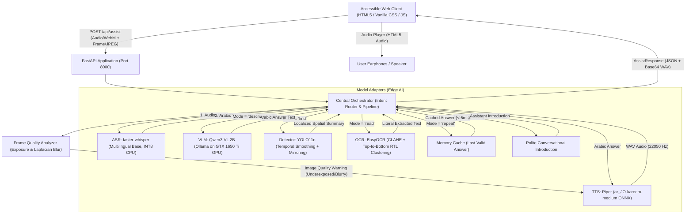

# System Architecture & Request Lifecycle

## 1. Project Overview
**Title:** Design and Development of an AI-Based Multimodal Intelligent Assistant for Assisting Blind and Visually Impaired Individuals in Real-Time Environment Recognition and Voice Interaction.

The system is designed as a local, privacy-preserving, multimodal edge assistant running on a Windows 11 host with resource-aware orchestration. It requires no cloud API keys, preserves all personal audiovisual data locally on Drive X:, and maintains interactive latency through disciplined memory management and GPU offloading.

---

## 2. Component Architecture

---

## 3. End-to-End Request Lifecycle

1. **User Utterance & Frame Capture:**
   - The user presses and holds Space (Push-to-Talk) or taps the microphone button.
   - The client records user speech using `MediaRecorder` in `audio/webm;codecs=opus`.
   - Concurrently, a synchronized video frame is extracted from the local camera canvas as JPEG with timestamp and frame ID metadata.
2. **ASR Stage (Speech-to-Text):**
   - The audio stream is ingested by `faster-whisper` (`base` model, CPU INT8).
   - Arabic transcript is returned (e.g., "شنو قدامي؟" or "وين القنينة؟").
   - Empty or silent queries are rejected with an audible Arabic reminder.
3. **Deterministic Arabic Intent Routing:**
   - The orchestrator normalizes Arabic diacritics, hamzas, and punctuation.
   - Rule-based regex deterministically classifies commands:
     - `repeat`: "كرر", "عيد", "شنو كلت ما سمعتك" -> returns last valid answer from memory without model invocation.
     - `greeting`: "مرحبا", "السلام عليكم" -> returns polite introductory response.
     - `read`: "اقرأ", "النص", "المكتوب" -> routes to EasyOCR.
     - `find`: "وين [كائن]", "أين", "ابحث عن", "شوفلي" -> extracts target object alias and routes to YOLO11n.
     - `describe`: "صف المشهد", "شنو قدامي", "شكو كدامي" -> routes to VLM.
     - `ask`: any general visual inquiry -> routes to VLM.
4. **Frame Quality Pre-Check:**
   - The `FrameQualityAnalyzer` computes image brightness mean and Laplacian variance.
   - If severe underexposure (< 35.0) or blur (< 40.0) is detected, the pipeline produces immediate spoken guidance ("الصورة مظلمة جداً" / "الصورة مشوشة") before invoking heavy models.
5. **Visual Inference Stage:**
   - **For 'read':** EasyOCR applies CLAHE contrast enhancement, detects text boxes with CRAFT, clusters lines vertically top-to-bottom, and sorts words right-to-left for authentic Arabic reading order.
   - **For 'find':** YOLO11n detects common objects. Supported aliases map to COCO80 classes. Spatial positioning accounts for user camera mirroring:
     - Left ($x_{norm} < 0.38$), Center ($0.38 \le x_{norm} \le 0.62$), Right ($x_{norm} > 0.62$).
     - Bounded temporal smoothing (2.0s TTL) prevents flickering announcements.
     - Unsupported classes (doors, stairs) return honest technical notifications.
   - **For 'describe' & 'ask':** Image is normalized to long-edge 640px and sent to Ollama `/api/chat` with Qwen3-VL 2B running on the GTX 1650 Ti GPU. Grounded, concise Arabic answers are returned.
6. **TTS Stage (Text-to-Speech):**
   - The Arabic response is synthesized into PCM audio using `piper-tts` with the `ar_JO-kareem-medium` voice at 22,050 Hz.
   - Formatted into an in-memory WAV container and encoded in Base64.
7. **Client Delivery & Playback:**
   - The client renders the Arabic text into an ARIA live assertive region.
   - Audio is played through HTML5 Audio. Keyboard controls (C, D, R, F, A, Esc) are protected against triggering inside input text fields.

---

## 4. Hardware Resource Strategy (LOW_MEMORY Profile)

| Component | Runtime | Device | Precision / Quantization | Memory Allocation |
| :--- | :--- | :--- | :--- | :--- |
| **ASR** | faster-whisper | CPU | INT8 | Bounded CPU threads, resident ~190 MB |
| **Detection** | Ultralytics YOLO11n | CPU | FP32 | Resident ~45 MB RAM |
| **OCR** | EasyOCR + CLAHE | CPU | PyTorch CPU | Lazy loaded, resident ~320 MB RAM |
| **VLM** | Qwen3-VL 2B via Ollama | Discrete GPU (GTX 1650 Ti) | GGUF Q4_K_M | ~1,050 MiB VRAM on GPU; ~335 MB Host RAM |
| **TTS** | Piper | CPU | ONNX FP32 | Resident ~85 MB RAM |
| **Orchestrator** | FastAPI / Uvicorn | CPU | Python 3.12 | Total Process RSS: ~728 MB RAM |

---

## 5. Security and Privacy Boundaries
- **Zero Cloud Dependence:** All models and inference run exclusively on localhost (`127.0.0.1`).
- **No Personal Data Retention:** Audio recordings and camera frames are discarded immediately after inference.
- **Untrusted Input Isolation:** Spoken transcripts, OCR text, and VLM answers are treated as untrusted text presentation data and are never piped to system shell commands or arbitrary interpreters.
